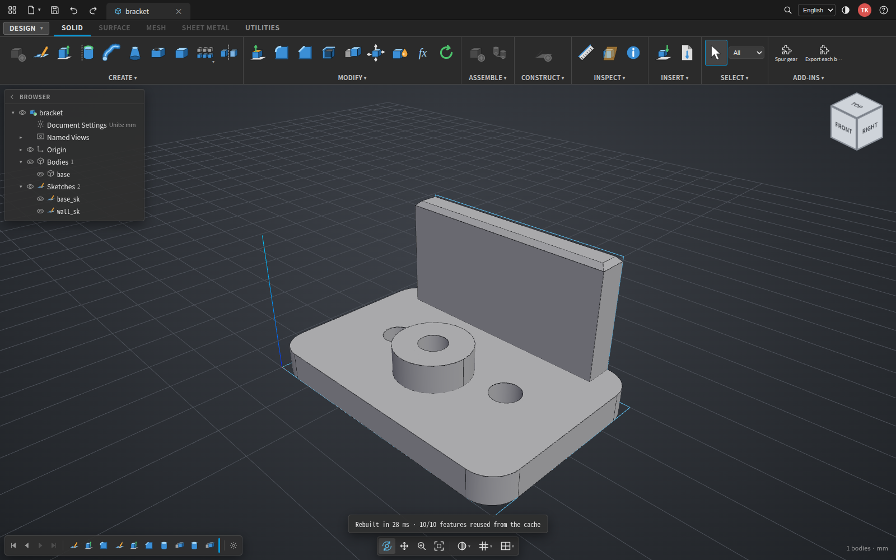
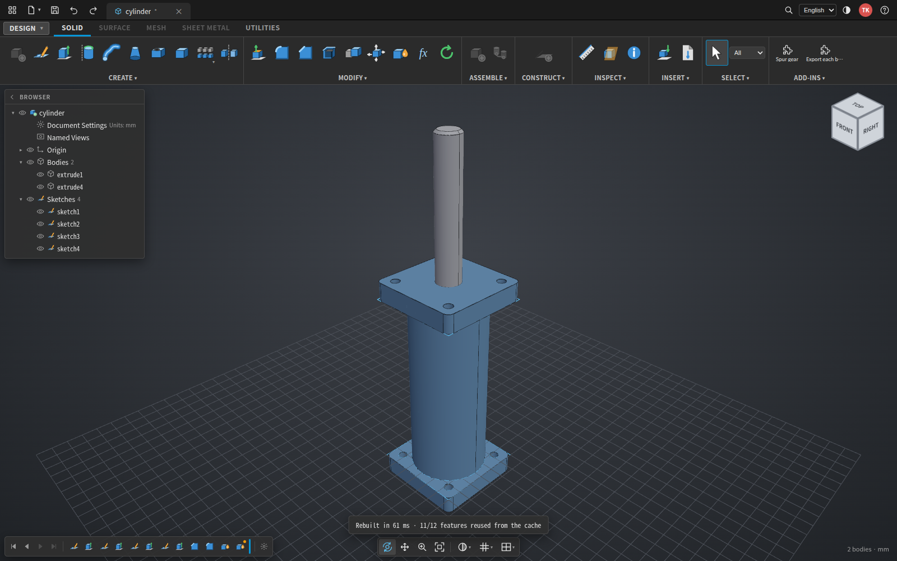
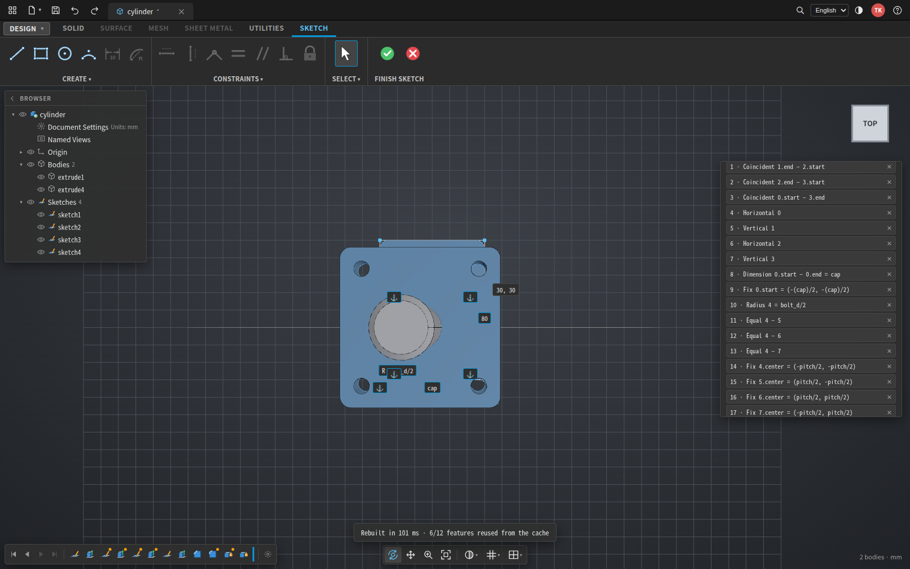

# cadrust

**A Fusion-style parametric solid modeler written in Rust, running in the browser and on the command line.**

cadrust is a feature-based CAD system on top of Open CASCADE Technology (OCCT 8.0, reached through
the [`cadrum`](https://crates.io/crates/cadrum) crate). One document format (`.cadrust.json`) drives a
three.js web app laid out like Autodesk Fusion's Design workspace and a headless CLI that evaluates,
converts and exports the same documents. The kernel also compiles to WebAssembly, so the web app runs
without any server. CAD, in Rust, hence the name.



## Overview

This project was also undertaken to gauge how far AI-assisted reverse engineering of software has
come: starting from the visible commands and menus of a modern parametric modeler, how much of a
working modeler (kernel, document model, constraint solver, naming, user interface) can be rebuilt on
open-source foundations, and how well the result holds up under scripted end-to-end tests. With the
main modelling features in place that question is answered, so active development has stopped at this
point; further features will be added now and then as personal time allows. The project is shared as
it stands, and issues and pull requests are welcome.

- **Sketch, constrain, extrude.** Sketches with lines, arcs, circles, rectangles and polygons on base
  planes or on any planar face of a body; a 2D constraint solver (horizontal, vertical, coincident,
  distance, radius, fix, equal, parallel, perpendicular) with a live degrees-of-freedom read-out.
- **Feature timeline.** Extrude (one or two sides, symmetric, taper, through all), revolve, sweep, loft,
  box, cylinder, sphere, torus, hole (simple, counterbore, countersink), fillet, chamfer, shell, combine,
  move, scale, mirror, rectangular and circular patterns, split body, offset face (press / pull), delete,
  appearance, STEP / BRep import as a feature. Every body-creating feature takes a boolean operation
  (new body, join, cut, intersect).
- **Persistent naming.** Every face is named when it is born (`base/e2`, `plate/z+`, `soft/f0`) and
  carried through booleans, fillets, chamfers, shells, moves and patterns, so picked edges and faces
  survive edits upstream in the timeline.
- **Dependency graph and incremental evaluation.** Features form a DAG; each gets a content key from its
  definition, the parameters it mentions and the keys of its inputs. Unchanged keys are replayed from a
  cache, so a parameter or constraint edit recomputes only the downstream subgraph and undo is free.
- **Fusion-style UX.** Application bar, ribbon with tabs and labelled groups, floating Browser,
  ViewCube, docked command dialogs, navigation bar, timeline with a history marker, marking menu,
  Data Panel with folder browsing, Save As / Export dialogs, themed scrollbars and splitters, dark and
  light themes, English and Korean.
- **Add-ins.** Sandboxed WebAssembly or JavaScript add-ins with a manifest-driven dialog; the same
  module runs in the browser and in the CLI.
- **Serverless.** The whole kernel (OCCT included, 29 MB) runs in a Web Worker when no server is present.

A pneumatic cylinder modelled end to end through the UI by a scripted session (constrained sketches,
end caps sketched on faces, rod, chamfer, fillet, colours), with a STEP file saved after every stage
and a recorded walkthrough in [`doc/cylinder_modeling.mp4`](doc/cylinder_modeling.mp4):



Editing a constraint in the rear cap sketch (the Fusion-style sketch environment with its palette,
dimensions and constraint list):



## Installation

Prerequisites:

| what | why | notes |
|---|---|---|
| Rust stable (1.80 or newer, via [rustup](https://rustup.rs)) | everything except the browser page | no OpenCascade install is needed: `cadrum` downloads a prebuilt OCCT during the first build |
| Docker | only for the WebAssembly kernel (`scripts/build-web.sh`) | uses the `ghcr.io/lzpel/cross-wasm32-unknown-unknown` image |
| Python 3 with Playwright | only for the browser tests and the recorded walkthrough | `pip install playwright && playwright install chromium` |
| ffmpeg | only to convert the recorded walkthrough to mp4 | optional |

Build and test:

```bash
git clone https://github.com/mac999/cadrust.git
cd cadrust
cargo build --release          # about 40 s from scratch; OCCT ships prebuilt
cargo test --release
```

The binary is `target/release/cadrust`. The first build downloads the OCCT archive (about 100 MB).

## Usage

### Web app with a server

```bash
./target/release/cadrust serve examples/bracket.cadrust.json --port 8080
# open http://127.0.0.1:8080/   (add ?lang=ko&theme=light to preset language and theme)
```

The server evaluates documents, serves the page and keeps an incremental evaluation cache. Ctrl+S
saves the design where it lives; **File > Save As…** opens a dialog to pick a folder under the project
(with new-folder creation), a location on this computer (system save dialog in Chromium browsers, or
a download) or browser storage. **File > Export…** writes STEP, STL, BRep, glTF or JSON the same way.
The Data Panel browses the project folders. Set `CADRUST_WEB_DIR=web` to reload `index.html` on every
request while editing the page.

### Web app without a server

```bash
./scripts/build-web.sh                      # kernel -> web/cadrust_wasm.wasm, add-ins, examples (Docker, about 30 s)
python3 -m http.server 8090 --directory web # any static server; the page detects the missing API
```

In serverless mode the kernel runs in a Web Worker, designs are saved to browser storage or
downloaded, and STEP import is done in the browser as well.

### Command line

```bash
# evaluate a document, override a parameter, export
cadrust run examples/bracket.cadrust.json --set width=80 -o bracket.step -o bracket.glb -o bracket.png

# inspect or convert any STEP / BRep
cadrust info bracket.step --json
cadrust convert bracket.step -o bracket.stl

# wrap a STEP file as an Import feature (a new document, or appended to an existing one)
cadrust import part.step -o part.cadrust.json
cadrust import part.step -o model2.cadrust.json --into model.cadrust.json --id part

# feature dependency graph as Graphviz DOT
cadrust graph examples/bracket.cadrust.json | dot -Tsvg > bracket_graph.svg

# add-ins: inspect and run one from the command line
./scripts/build-addins.sh                                   # Rust add-ins -> addins/dist/*.wasm
cadrust addin info addins/dist/gear-generator.wasm
cadrust addin run addins/dist/gear-generator.wasm model.cadrust.json --param teeth=24 --param module=2
```

### Keyboard

`E` extrude, `Q` press pull (face selected: offset face; edge selected: fillet; nothing: extrude),
`F` fillet, `M` move, `H` hole, `A` appearance, `I` measure, `S` tool search, `Home` fit,
`Ctrl+Z` / `Ctrl+Y` undo / redo, `Ctrl+Enter` compute all, `Ctrl+S` save, `Ctrl+Shift+S` save as,
right click marking menu, `?` the full list. In a sketch: `L R C A` line / rectangle / circle / arc,
`V` select, `H V D X` horizontal / vertical / dimension / fix.

## The UI

The chrome follows Fusion's Design workspace one to one so a Fusion user finds every tool where they
expect it: application bar on top, ribbon with tabs and labelled groups, Browser floating on the left
of the canvas, ViewCube top-right, command dialogs top-right, navigation bar bottom-centre, timeline
bottom-left. The ribbon icons are generated two-tone glyphs in Fusion's visual language; primitives
and the direct-edit tools sit in the CREATE / MODIFY drop-downs rather than in the row. When the window
is too narrow the ribbon folds low-priority commands into their group drop-downs (one icon always left
per group) and only shows a thin scrollbar when even that is not enough. Groups that cadrust does not
implement (New Component, Joint, Offset Plane, Surface / Mesh / Sheet Metal tabs) are shown greyed out
rather than hidden. Scrollbars and the splitter handles on the Browser, the Data Panel and the dialog
stack take their colours from the theme tokens; panel sizes persist in the browser.

Timeline: feature icons with warning badges, playback buttons and a history marker (roll back, insert
at the marker, "roll here" from the context menu); hovering a feature highlights its upstream and
downstream chain and the rebuild message reports how many features were replayed from the cache.

## Document format

```json
{
  "parameters": { "width": "60", "hole_d": "6.5" },
  "timeline": [
    { "type": "Sketch",  "id": "sk", "plane": "XY", "entities": [
        { "type": "Rect", "x": 0, "y": 0, "w": "width", "h": "40" },
        { "type": "Circle", "cx": "width / 2", "cy": 20, "r": "hole_d / 2" } ] },
    { "type": "Extrude", "id": "base", "sketch": "sk", "distance": "6" },
    { "type": "Fillet",  "id": "soft", "body": "base", "radius": "6", "edges": "vertical" }
  ]
}
```

The first sketch entity is the outer loop, the rest are holes. Every number accepts an expression over
the parameters. A feature that creates a body registers it under its own id; a feature that modifies
one keeps the id, so later features reference the same name. A picked edge is stored as
`"edges": {"pick": [[x, y, z]], "names": ["base/e0|base/end"]}`, a sketch on a face as
`"plane": {"face": {"body": "base", "point": [x, y, z], "name": "base/end"}}` and an offset face as
`"faces": [{"body": "base", "point": [x, y, z], "name": "base/z+"}]`; the web app fills the names in
automatically, hand-written documents may give either. An `Import` feature keeps the geometry as
base64 BRep in `data`, so a document with imported parts is still a single file. Sketch constraints
are stored next to the entities (`constraints: [{"type": "Distance", "a": {"e": 0, "p": "start"}, ...}]`).

`examples/` holds the bracket used throughout, `phase2` (holes, patterns, sweep, loft), `phase3`
(a fully constrained outline, sketches on faces, a picked-edge fillet) and the cylinder with its
per-stage STEP files.

## Add-ins

An add-in is a `wasm32-unknown-unknown` module with four exports (`addin_alloc`, `addin_free`,
`addin_manifest`, `addin_run`) that exchange JSON through a packed byte buffer, or a JavaScript module
exporting `run(command, params, api)`. The manifest declares commands and typed parameters; the host
builds the dialog from it. A wasm add-in receives `{command, params, document, selection}` and returns
`{document, message}`; the host applies the new document as one undoable step. The same module runs
in the browser (`web/addin_host.js`) and under `wasmi` in the CLI (`crates/cadrust-addin`).
`addins/sdk` is a 60-line Rust SDK (`cadrust_addin_sdk::addin!(MANIFEST, handler)`);
`addins/gear-generator` (involute spur gear) is the reference add-in and `step-batch-export` the
JavaScript one.

## Layout

```
crates/cadrust-core   document schema, expressions, sketch solver, timeline evaluation, persistent naming,
                      dependency graph + evaluation cache (Model)
crates/cadrust-cli    cadrust binary: run / convert / info / import / graph / serve / addin (Controller)
crates/cadrust-wasm   kernel exports for the browser (cadrust_init / run / export / import), no wasm-bindgen
crates/cadrust-addin  wasmi host for add-ins (manifest, run) used by the CLI and the server listing
addins/sdk            Rust SDK for writing add-ins; addins/gear-generator  reference add-in; addins/dist  built add-ins
web/index.html        three.js viewer and the Fusion-style chrome, embedded into the binary at build time (View)
web/cadrust_wasm.js   glue for the wasm kernel; web/kernel_worker.js  Web Worker; web/addin_host.js  browser add-in host
scripts/              build-addins.sh, build-web.sh
tests/e2e/            Playwright suites (see tests/e2e/README.md)
examples/             sample documents and the cylinder STEP files
doc/                  screenshots and the recorded walkthrough
```

## Testing

```bash
cargo test --release                     # kernel: evaluation, naming, booleans, cache, import round trip
python3 tests/e2e/p4.py                  # browser suites, see tests/e2e/README.md
python3 tests/e2e/cyl.py                 # the cylinder scenario (writes examples/cylinder_*.step)
```

Measured on a desktop Linux machine: the 10-feature bracket evaluates in about 20 ms natively and
140-180 ms in the browser build; a full `cargo build --release` from scratch takes about 40 s because
OCCT ships prebuilt, and the wasm kernel builds in about 30 s inside the Docker image.

## Status and limits

Implemented: sketching with constraints, the feature set above, persistent naming, incremental
evaluation, the Fusion-style web app, the CLI, the serverless build and add-ins. Not implemented: draft (no
draft-angle call in `cadrum` yet; taper is done by lofting to the 2D-offset profile), extrude "to
object", non-uniform scale, split by sketch or face, surface / mesh / sheet metal workspaces, joints,
named views and comments (placeholders in the Browser), STEP metadata validation through ruststep,
the WIT component-model add-in API (a packed-buffer ABI is used instead).

## Licences

| component | licence |
|---|---|
| cadrust | MIT |
| cadrum | MIT |
| ezpz (kcl-ezpz, 2D constraint solver) | MIT |
| Open CASCADE Technology 8.0 (statically linked by cadrum) | LGPL-2.1 with the OCCT exception; unmodified, version pinned by the crate |
| three.js | MIT |
| wasmi (add-in host) | MIT / Apache-2.0 |
| axum, tokio, serde, clap, evalexpr | MIT / Apache-2.0 |

## Author and acknowledgements

**Taewook Kang** ([laputa99999@gmail.com](mailto:laputa99999@gmail.com), [github.com/mac999](https://github.com/mac999)).

This project draws on the author's experience developing CAD engines. The feature set and the menu
structure of commercial parametric modelers were reviewed at the level of their visible commands only,
to decide which operations a modeler of this kind needs and how they are usually grouped; the
implementation itself is built from existing open-source libraries and published algorithms
(B-rep modelling and boolean operations in Open CASCADE Technology, constraint solving, persistent
naming by face history, content-keyed incremental evaluation). No third-party CAD code or binaries
were used. Product names mentioned in this repository are trademarks of their respective owners, who
are not affiliated with this project.

Thanks to the projects this one stands on: Open CASCADE Technology, the `cadrum` crate that brings it
to Rust and WebAssembly, the `kcl-ezpz` constraint solver, three.js, wasmi, axum and the Rust
ecosystem.
